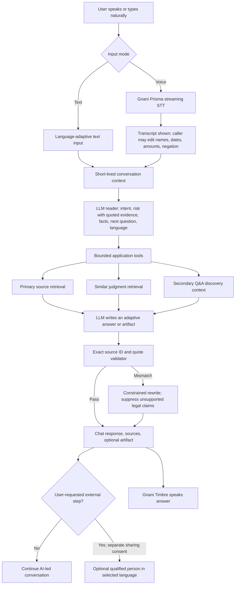

# Nyaya: model-led, source-grounded architecture

## Architecture goal

The AI should understand a person's story, continue a natural conversation, find the right tools and evidence, and produce situation-specific work in the person's language. Prompts define the system's responsibilities and evidence constraints. They do not contain fixed answers or fixed questions.

This is a legal-information assistant with explicit abstention and approval boundaries. It is not a lawyer, court, legal-aid authority, or autonomous filing agent. A generative model can still be wrong even when it cites a real source; source coverage, interpretation, procedure, and later case treatment remain separate correctness problems.

## Runtime turn

### Implemented turn stages

1. **Voice capture:** Prisma streams transcript segments through a server-side WebSocket proxy. The caller is **not asked which language they speak**: the stream opens in `indic-auto`, Prisma v3 identifies the language of every utterance, and the proxy forwards `detected_language_code` with the transcript. An explicit choice in the interface is only an override. `format=codemix` keeps a Hindi sentence with English legal nouns as one utterance instead of normalising the mix away. The text remains editable before sending, and the user does not confirm a generated facts form every turn.
2. **Short-lived context:** the session store keeps the latest exchanges plus an explicit fact ledger in local SQLite. It expires after four hours or on deletion, and no transcript archive is written anywhere else.
3. **Retrieval:** the application queries approved legal source records, the bundled and locally imported judgment subset, and the Q&A dataset, before any model runs. The query is the call, not the sentence: the caller's recent substantive turns, the open intake's reviewed vocabulary, and the previous turn's model-written `search_query` are searched together when the current turn only points at the matter. The Q&A corpus is explicitly marked secondary. The model cannot call arbitrary URLs or shell commands.
4. **One consultation call:** `prompts/legal_agent.md` asks for a single JSON object that contains both the answer and the reading — intent, risk findings with a verbatim evidence span each, grounded facts with provenance, the single most useful next question, the caller's language, an optional curated `procedure_id`, and the legal-vocabulary search phrasing. There is no separate reader call in front of it; two calls on every turn met the provider's minute quota twice as fast and paid two time-to-first-tokens before the caller heard anything.
5. **Validation, not trust:** `app/understanding.py` validates the reading out of that same payload. Closed vocabularies reject unknown intents, categories, slots and procedure ids; evidence must occur in the caller's own words, this turn or an earlier one; ungrounded facts are dropped; risk is the union of the model's findings and the lexical net, so it can only rise; and an `emergency` intent with no grounded evidence raises urgency to `high` but cannot trigger the safety script. The validated facts, corrections and matter then enter the ledger and advance the intake.
6. **Route settlement:** the phrase net has to route before any model runs — retrieval and the safety net need a route then, and a person in danger must not wait for a model. That early verdict is not the final one. Once the reading is validated, `routing.settle` lets it settle the route: an emergency is never lowered, only raised; a caller who asked for a person keeps that route unless the model read an actual legal question in the same message; an unconfident reading does not overwrite a settled route; and an `emergency` *intent* without grounded evidence raises urgency without moving the turn onto the safety script. Until this existed the interface reported a category the model had already contradicted.
7. **Evidence checks:** every emitted legal-claim record must cite an ID that was retrieved and an exact quote contained in that source, and that quote must contain every number the claim asserts — a quote from the neighbouring provision passes a substring test while saying something else. When a model is configured, a second cheap call then asks the entailment question directly (does this passage state this proposition?), and a claim that only survived string matching can still fail there. The spoken `reply` is checked too: a section number, period, rate or sum in an asserted sentence that no verified quote and no caller statement contains ends the generated answer. A number inside a question is not treated as an assertion. There is **no repair round**: a rejected claim or an unsupported number falls straight to the deterministic grounded reply, which quotes what was actually retrieved and labels it uninterpreted.
8. **Voice output:** Timbre streams the response sentence by sentence over one AudioContext, in the language that was decided for the turn. A single base language is sent as its own code; Hinglish and anything unlisted are sent as `auto`, which is Timbre's documented mixed-content path, so a mixed reply is not forced into one language and mangled. The server, not the browser, owns the voice/model/language triple, because a mis-paired voice is a hard 400 that would land after the caller was promised an answer.
9. **Optional human connection:** regular help remains AI-led. The interface offers a qualified-person connection when the caller asks for one or a draft is intended for formal submission. The user must choose the action and approve sharing the displayed summary. Nothing is filed or sent by this prototype.

## Conversation state, triage and privacy

Three deterministic layers sit beside retrieval. They exist because the reliability failures in this product class are not retrieval failures: they are forgetting what the caller said, treating urgency as a style problem, and leaking an identifier.

### Fact ledger (`app/facts.py`)

The transcript is not the state. Each turn merges caller-stated facts into a slot table — jurisdiction, date, amount, notice, stage — with the source of each value (`caller`, `ui`, `reader`, `net`) and the turn it came from.

**The reading is the extractor; the pattern pass is the floor.** `facts.extract` runs on every turn so a provider outage cannot leave the ledger empty and so a state named in the message is known *before* retrieval, but it writes with source `net`, and a grounded `reader` value for the same slot replaces it — re-reading one message more precisely is not the caller changing their story, so it is not reported as a conflict. A natural-language amount no regular expression in `facts.py` can read ("one and a half lakhs", "three months of salary") reaches the ledger only through the reading, and that is the intended path: a pattern match on a caller's words never outranks a reading of them.

A `reader` fact is written only if the reading quoted the caller's own words, and it can never overwrite a value the caller stated. Slots are ordered by materiality per route, so a gap filled by the reading closes the question rather than a generic prompt following it. A repeated slot with a different value is recorded as a conflict, the newest value wins, and both are shown to the caller. A stated city is never converted into a state: mapping Mumbai to Maharashtra is an inference, and the reader prompt forbids inferring location. The ledger persists with the session and is exposed at `GET /api/session/{id}/state` so the person it describes can inspect and dispute it.

### Risk triage (`app/triage.py`)

A turn is classified into risk categories (immediate danger, self-harm, child at risk, fraud in progress, domestic violence, eviction, deadline pressure, custody) with a severity and, crucially, a policy set. Policy is what changes behaviour:

| Policy | Effect |
|---|---|
| `block_drafting` | no artifact is returned, even if the model produced one |
| `safety_first` | emergency script, safety question first, no legal analysis |
| `no_legal_analysis` | the emergency route is used and retrieval is skipped |
| `report_now` / `preserve_evidence` | the reporting step is surfaced ahead of legal theory |
| `rights_first` | custody turns lead with rights and immediate steps |
| `mention_deadline_without_computing` | a date is acknowledged, never computed |

Triage is not the primary decision-maker: the semantic reader classifies risk from meaning, including paraphrases and code-mixed speech that no phrase list holds. Triage is the *net* underneath it, and the two are unioned, so either detector can force the safety route and a model reading can never lower a severity. This matters in both directions. A model that reads "he will come at night and finish me" correctly as critical when every phrase list misses it; a provider outage that still routes a bare "he is beating me" to the safety script. Devanagari patterns stay in the net because a caller in danger does not switch script for the assistant's convenience. A draft requested during an active threat is withheld: delay is the safer failure.

### Privacy boundary (`app/privacy.py`)

Aadhaar, PAN, passport, driving licence, phone, email and account numbers are masked in every log record, masked in the review handoff by default, and reported back to the caller when detected in their own message. Masking is never silent: the review modal fetches exactly what would be sent (`POST /api/review/preview`), shows it, and offers an explicit opt-in to include the identifiers. A generated draft that contains an identifier says so in its warning instead of quietly carrying an Aadhaar number into a notice.

### Provider resilience (`app/model_gateway.py`)

A structured completion is retried on 408/409/425/5xx, a timeout or unparseable JSON, within a whole-turn budget (`LLM_BUDGET_SECONDS`, default 18s). A 4xx that cannot improve (bad key, unknown model) is not retried. When the budget is exhausted the turn degrades to passage display rather than hanging a voice reply.

The turn makes **one consultation call**. Tool definitions may add one round — the model asks for a search, the engine runs it, the model answers — and that is the ceiling. A 429 gets exactly one short retry and no more: measured, three retries turned one throttled question into a 37-second turn that degraded anyway. The gateway also keeps a local 60-second token window (`LLM_TPM_BUDGET`, disabled by default because the provider's limit cannot be inferred from the model name) and waits for room instead of collecting the 429; `usage_snapshot()` reports the provider's own counts and rate-limit headers at `/api/health`.

A JSON Schema is requested only where the call does not use tools (`LLM_STRUCTURED_MODE=auto`); a 400 makes the gateway remember that and fall back to `json_object`, so a server without guided decoding costs one failed request ever, not one per turn.

If the consultation is unavailable, the turn is still handled: the lexical net decides, deterministic fact extraction still runs and is recorded as the `net` floor, and the trace records `source: lexical` with the provider error. Nothing silently pretends a model read the call.

## Real-time voice path

Reversed from the shipped `@vapi-ai/web` package (v2.7.1) and the assistant configuration schema it sends, not from marketing copy. Four contracts define the behaviour a caller notices:

| Contract (as shipped) | What it actually controls | What this build does |
|---|---|---|
| `stopSpeakingPlan.numWords` | words the caller must say before the assistant yields | same, default 0 |
| `stopSpeakingPlan.voiceSeconds` | VAD spike used instead when `numWords` is 0 | same, default 0.2s |
| `stopSpeakingPlan.backoffSeconds` | how long before the assistant speaks again | same, default 0.8s |
| `acknowledgementPhrases` / `interruptionPhrases` | “haan/okay” never interrupts; “ruko/no/stop” always does | same lists, extended for Hindi, Devanagari, Tamil, Telugu, Bengali, Kannada |
| `startSpeakingPlan.waitSeconds` | floor before the answer starts | same, 0.4s |
| `transcriptionEndpointingPlan` | punctuation 0.1s, trailing number 0.5s, unfinished 1.5s | same shape, 0.35 / 0.5 / 1.2s |

`app/voice.py` owns these as data, and the browser and server share them (`GET /api/config` and `GET /api/voice/metrics` return the live plans). The client measures local microphone RMS for the VAD spike because waiting for a transcript to notice speech is the delay being avoided; the decision itself is server-side (`POST /api/voice/interrupt`) so every client and language is governed by the same thresholds.

**Barge-in is three stops, not one.** Local audio stops synchronously; the upstream Timbre synthesis stream is closed server-side through the speech turn's cancel event (`/api/voice/timbre?session_id=…&speech_id=…`), so nobody keeps paying for audio nobody hears; and the *record* is truncated to roughly what was heard (`truncate_to_heard`), because an untruncated transcript makes the next turn answer a sentence the caller never heard. Truncation is an estimate at 150 wpm and is labelled as one.

**Measured, not asserted.** `POST /api/voice/metrics` records browser-observed first-audio latency and barge-in stop latency; `GET /api/voice/metrics` reports p50/p95. On this machine first-audio and stop latency are stub-measured only — the Timbre endpoint is not configured here, so any sub-second claim about real synthesis is unverified.

The speech registry is a row in the shared session database, not a process-local dict: a barge-in received by one worker sets the event locally, and any other worker streaming that utterance notices within a poll interval and stops. The rate-limit counters live in the same database for the same reason — in-memory counters doubled the real limit as soon as there were two workers.

## Latency

Measured with [scripts/latency_bench.py](../scripts/latency_bench.py), which drives the real `answer_stream` orchestration against a parameterised provider (350 ms time-to-first-token, 120 tokens/s, 320-character reading). `previous_ordering` in that output re-runs the old control flow — read, acknowledge, generate in full — inside the same process, so the comparison shares one provider, one payload size and one clock.

| | previous ordering | current |
|---|---|---|
| acknowledgement spoken | 1748 ms | **0.1 ms** |
| intake: first spoken sentence | 1748 ms | **1532 ms** |
| legal answer: final (950-char reply) | 3359 ms | 3359 ms |
| legal answer: final (520-char, voice-capped reply) | 2463 ms | **2467 ms** |
| precedent: P95 | 3369 ms | 3039 ms |

What produced the difference:

- **Speak before thinking.** The acknowledgement event is emitted before the reader runs, and skipped entirely for an emergency. This is the cheapest large win in the whole pipeline and it is perceived, not measured: the caller hears a voice at 0 ms instead of silence.
- **Sentence-level streaming.** `generate_turn_stream` reads the `reply` string out of the JSON as it arrives (`partial_reply`), splits on sentence boundaries, and hands safe sentences to the voice while the object is still open. Verified against a real SSE endpoint, not only a mock.
- **The safety gate on early speech.** A sentence is spoken early only when it contains no digit and no legal marker (section, act, court, penalty, liable, deadline, …). Intake turns stream; a statute answer does not stream at all, because its first sentence is usually a legal proposition and propositions are spoken only after claim validation. That is the deliberate trade: about 1 s of extra silence in exchange for never speaking an unverified rule.
- **Retrieval overlapped with reading.** The source and judgment queries start in a worker thread before the model is called, so the 105 ms hybrid case retrieval is hidden behind the reading instead of added to it. The jurisdiction guess uses the same deterministic rule the reading is validated against; a mismatch re-queries once.
- **No third generation.** A failed claim repair now falls back to the deterministic grounded-only reply instead of paying for another full generation on the worst turns.
- **Tool capability probed once.** A server that rejects `tools` is remembered, instead of a failed generation followed by a retry on every turn.
- **Keep-alive HTTP.** One pooled client per event loop; a turn makes two to five model calls and used to pay a handshake on each.
- **Voice-length budget.** The prompt caps `reply` at ~90 words because only the opening ~340 characters are ever spoken; generating an essay that is then truncated was pure latency.

Caller-side additions are not in that table: STT finalisation (≈250–300 ms on the fast tier), network (≈80–110 ms), and TTS first audio (≈150–200 ms). The honest expectation from a phone is therefore about **1.9 s for an intake turn** and **2.7–2.9 s for a legal answer**, against published caller-side medians of 1.3–1.7 s for the fastest commercial platforms. The remaining gap is structural: the reading hop in front of the answer and the refusal to stream unverified legal prose.

## Finite-state intake workflows

`data/workflows.json` mirrors the node model in the shipped types (`ConversationNode`, `ToolNode`, model-calls-a-tool-to-exit) with one deliberate difference: the file, not the model, owns the graph. A conversation node carries `requires` (facts that must be known) and `transitions` conditioned on those facts; a tool node calls one reviewed tool and continues. Two workflows ship: unpaid-wages (branching on household vs company employer) and police-fir (branching on a written refusal).

The model may ask to advance with the `advance_workflow` tool. `app/workflow.py` refuses an undeclared edge, an unmet requirement, or a completed/aborted workflow, and the step asks again instead of pretending it was answered. An emergency aborts the *active* workflow rather than filing it as an intake answer; a finished one keeps its status. Progress is persisted in the session's `last_state` and returned as `workflow` (`step/total`, the next required fact, the deterministic question).

### The intake is a checklist behind a conversation, not a form

- **One question per turn.** When a model is configured the turn is composed by `_generated(..., intake=True)` with an `intake` block: the single slot the step still needs, the plain-English `ask`, whether the steps are already on screen, and any matters held. The reply acknowledges, answers a question the caller slipped in, and asks for that one slot in the caller's own language. With no model, the reviewed `ask` is returned verbatim as the floor.
- **The model decides whether to ask now; the reviewed flow supplies the fact.** The `intake` block is marked `advisory` and the model is told to answer the legal question first and ask the step's question only when it is still needed. Its own `next_question` is preferred over the scripted `ask` (`_question_for`), because it is written for this caller and this moment; the scripted `ask` is what the app says when there is no reading to prefer.
- **The graph still decides a transition.** The model cannot add, skip or reorder a step, and a transition happens only when the ledger holds the required fact, scoped to this intake. That is integrity, not consultation: it stops the app claiming a step was answered when it was not.
- **Facts are scoped to the matter they belong to.** A `Fact` carries a `matter`; the dates or documents of a police complaint cannot satisfy an employment intake. Re-stating a slot in a new matter is not recorded as a contradiction.
- **A terse answer keeps the intake.** A turn the reader cannot classify mid-intake keeps the route and procedure, so "haan, appointment letter hai" does not reset the conversation.
- **The steps are shown once.** The card appears at the start of the intake and again when it completes; reprinting it under every answer is what made an exchange read as a form.
- **A second matter is held, not lost.** Asking about another process mid-intake answers that question and records the matter; the completion turn offers it. A finished intake does not block the next one.
- **A repeated step is re-asked in different words.** Repeating the same sentence happens only when the step has been left open for a second turn.
- **Completion asks forward.** The last turn asks what to do next (a document, or walking the steps), never for a fact the caller already gave.

### Where an off-workflow question goes

A question that matches no workflow never touches `data/workflows.json`. The reader classifies it (`statute`, `precedent`, `draft`, `procedural`, `unclear`), retrieval runs over the approved source pack, the judgment corpus and the secondary Q&A, and the generated answer passes claim validation. A process question with no curated procedure still retrieves and still gets one focused follow-up. Workflows are opt-in intakes for two processes, not a gate the product sits behind.

## Native tool calling

`app/tools.py` exposes five bounded tools in OpenAI function format: `search_law`, `search_judgments`, `get_procedure`, `record_fact`, `advance_workflow`. The engine sends them with the generation call, executes what comes back (native `tool_calls`, or in-band `tool_requests` on a server without tool support), appends `role: tool` messages and re-calls, at most two rounds and four calls per round. Tool-retrieved sources join the turn's evidence before claim validation, so a claim may cite a passage the model fetched mid-turn — the RAG loop closes inside one turn.

The boundary is the point: every tool is read-only against a validated local corpus, or a guarded write whose arguments are checked against what the caller actually said. `record_fact` requires an evidence span present verbatim in the caller's message; `advance_workflow` requires a declared transition and the step's facts. There is no network, shell, file or action tool, so the worst a compromised model can do is retrieve the wrong passage.

## Model selection and language boundary

### Gnani components

- **Prisma v3.0 (default):** speech recognition with language identification. The realtime stream takes `language_code: indic-auto`, reports `detected_language_code` on every `transcript`, and accepts `format: codemix`, which is what makes mixed Hindi/English speech work without a language question. It also takes legal `keyterms`, a `topic`, and `previous_text` from earlier turns. Frames must be exactly 1,024 bytes of PCM16LE, so the proxy re-cuts browser buffers rather than rejecting them. A stream closes after fifteen minutes; the proxy re-dials and carries the last transcript over.
- **Prisma v2.5:** single language per session, no language identification, no `codemix`. It is a fallback only when the operator pins one language, and the app refuses to send `indic-auto` to it.
- **Timbre v3.0:** thirteen voices, each speaking all ten languages, with `auto` for mixed content. Voice names are **not** portable between v2.5 and v3.0 (a mismatch is a 400), so `app/speech.py` validates the pairing before synthesis. Model IDs, voices and the default voice are environment configuration, not browser constants.
- **Language identity** lives in `app/language.py`: an explicit choice, then the recogniser's detected code, then the script, then Romanised Hindi markers, then English. The chosen basis is returned to the client so a wrong guess is visible rather than silently shaping the whole call.
- **Evon v3.3 or another multilingual LLM:** turn reading and response generation through an OpenAI-compatible API. Both stages are structured JSON; neither receives tools that can act. Evon's model card lists English plus ten Indic languages, including Odia. The STT/TTS stages do not list Odia, so this app serves Odia as text and reports `tts_language: unavailable` rather than voicing it in a guessed language.

“Indian languages” is not a single capability flag. Speech recognition, generation, legal terminology, script normalization, and speech synthesis each need language-specific evaluation. A voice code proves audio support only; it does not prove legal reasoning quality. Romanized text and code-switching need separate evaluation from native script.

The Evon model card warns that its general benchmarks are not a substitute for domain-specific safety evaluation and does not recommend unreviewed high-stakes legal use. The LLM is thus a conversation and synthesis component, not the legal authority. In a public deployment, legal content needs a professionally curated source store and specialist evaluation for every supported language and jurisdiction.

## Bounded tool layer and service coverage

`data/service_catalog.json` defines capability boundaries, not answer scripts. The model can choose one or more capabilities from the current turn and can handle requests that are not in the sidebar examples.

Current capabilities include source-grounded legal explanation, similar-case comparison, explanation of pasted notice text, organizing a reported timeline/evidence, tracking caller-provided dates, preparing a source-supported document draft, legal-aid preparation, safer next-step organization, translation/rephrasing, and situation-specific questions.

The app does not currently have a secure document-upload pipeline, OCR, official filing integration, court fee calculator, legal deadline calculator, phone/bank/police connector, or treatment-aware citator. The model must not claim to have performed one of those actions. A text pasted by the caller can be summarized, but a short excerpt cannot verify a complete court notice.

## Legal evidence and precedent policy

### Source types and their permitted uses

| Corpus | Runtime role | Can it establish a current legal rule? |
|---|---|---|
| `legal_sources.json` official/approved primary source excerpts | Citation-grounded legal claims | Only when the exact record is approved, applicable, in scope, and retrieved. Current prototype coverage remains very small. |
| Supreme Court / High Court judgments | Explain what a named court decided; compare fact patterns | No, not from similarity alone. Decision date, court, posture, jurisdiction, later treatment, and controlling statute matter. |
| `viber1/indian-law-dataset` Q&A | Vocabulary and research leads | Never. Rows are unverified, may be incomplete or outdated, and are not cited. |

The supplied judgment datasets include judgment text and metadata, but not a complete treatment graph showing whether every case was appealed, distinguished, overruled, or superseded. A production citator must add those relationships from verified sources. Similarity search cannot determine precedent value.

For legal propositions, production should keep a claim ledger with:

- proposition text and one or more exact source passages;
- source authority, jurisdiction, effective date, source version and checksum;
- case citation, court, bench, decision date, procedural posture and disposition where applicable;
- linked statute version and amendment history;
- treatment state with provenance and checked date;
- retrieval rank and model/prompt version for audit.

If an authority is missing, stale, conflicting, from the wrong jurisdiction, or the material facts are unclear, the assistant should say what it could not verify and continue with non-legal organization help. Model confidence must never bypass source and action gates.

## Dataset installation and production-scale indexing

The 24,607-row Hugging Face Q&A dataset is included under `data/indian-law-dataset.json` and indexed locally into a separate FTS5 database as secondary context.

The two case corpora are dramatically larger than the project workspace. The High Court dataset documents roughly 17.8 million judgments and about 1.25 TiB of tar archives; the Supreme Court dataset documents roughly 35,000 judgments and about 52 GB. The project bundles 1,679 Supreme Court records from 2024–2025 and 131 Sikkim High Court records from 2024 in `data/public_judgment_subset.jsonl`. The current environment only had about 16 GiB available, so this is not a local mirror of either full corpus. A filtered, size-budgeted importer adds selected public S3 partitions to `.runtime/legal-data/judgments.jsonl`; the bundled and imported files are both indexed into SQLite FTS5.

A third store sits beside those two: `legal_pipeline/` turns the gated `opennyaiorg/InJudgements_dataset` into **10,588 judgments at passage granularity** — 94,843 excerpts of ~3,600 characters, each with an int8 unit vector, its court tier, jurisdiction and language — in one 531 MB SQLite file. That store is read-only and rebuilt offline, not imported at boot; `app/judgment_corpus.py` queries it and `app/case_corpus.py` fuses its ranking with the curated partitions before reranking. [`retrieval.md`](retrieval.md) is the design record for that path.

For production scale, use an immutable data lake and a separate retrieval service:

1. **Bronze:** versioned raw S3 objects, manifests, checksums, dataset attribution/license and source metadata. Preserve upstream object keys and ingestion timestamp.
2. **Silver:** parse PDFs and metadata; identify language/script; extract per-page text and document structure; OCR only where the PDF lacks usable text; deduplicate with upstream identities (`cnr`, `decision_date`, `order_number` when present) and keep source variants.
3. **Gold:** paragraph and provision aware chunks that preserve case heading, section, page, court, date, citation, language, jurisdiction, authority, source hash and treatment metadata.
4. **Retrieval:** hybrid multilingual BM25 + dense retrieval, reciprocal-rank fusion, exact citation/section search, metadata filters, then a calibrated cross-encoder reranker. Keep judgments, statutes, official guidance, and Q&A in separate namespaces.
5. **Authority graph:** explicit statute-to-amendment, case-cites-case, appealed-by, followed-by, distinguished-by, overruled-by, court hierarchy and jurisdiction edges. Do not derive a conclusive treatment status solely from an LLM extraction.
6. **Serving:** stateless FastAPI workers, Redis for ephemeral dialogue state and rate limits, object storage for approved artifacts, PostgreSQL for source/version/workflow records, OpenSearch or a vector/keyword service for retrieval, and a queue for ingestion. Enforce tenant isolation and retention/deletion policy.

The local SQLite retrieval adapter is intentionally simple enough to run on a laptop and can be replaced behind the same interface. It is not the complete production-scale search stack.

## Latency design

The speech endpoints are streaming, and retrieval indices are local. LLM planning plus response generation adds inference time. End-to-end time depends on model hosting, network, source retrieval, language, response length, and voice synthesis; the project reports observed turn latency and makes no sub-second guarantee.

To keep interaction fast in production:

- host Evon close to the API/retrieval services or use a low-latency compatible endpoint;
- cap retrieved passages and context to relevant evidence, not the entire judgment;
- retrieve lexical and dense candidates concurrently, then rerank only the top set;
- cache immutable source embeddings and normalized queries, not personal facts;
- stream an initial non-legal acknowledgement only if it is generated and safe; hold legal claims until source validation completes;
- synthesize validated answer chunks through Timbre and start playback as soon as the first validated sentence is ready;
- use per-language load tests and p50/p95/p99 measurements from speech end to first audible response.

For high-risk answers, don't remove a verification stage just to improve latency. If a verifier is too slow, withhold the legal claim and still provide lower-risk organization or a focused source-gap question.

## Safety and approval gates

### Actions that can happen automatically inside this app

- interpret the user's request and select allowed retrieval capabilities;
- search the configured local data and generate a response, translation, summary, timeline, or draft;
- show supporting sources and the limits of any similar-case comparison.

### Actions requiring an explicit user decision

- sending a summary to a human reviewer, with separate consent to share;
- saving an artifact to session memory;
- any future external submission or message integration.

### Actions not implemented

Court filing, service of process, payment, bank or police contact, submission of a document, guaranteed deadline calculation, and legal-aid eligibility decisions.

For a document intended for filing or formal service, the assistant must state in the caller's language that AI may have made mistakes or omitted requirements and offer a qualified human in that language. It must not default to a human connection. The caller can decline and continue using other AI services. This prototype does not support the final external submission step.

## Evaluation plan before deployment

Evaluate each stage separately, then measure complete-turn outcomes. Do not treat general model benchmarks as legal accuracy.

### Retrieval

- recall@k, nDCG, and exact authority recovery across state, court, issue, year, language and transliteration;
- correct retrieval of current statute version and negative/overruled treatment;
- deduplication quality and source-link integrity;
- multilingual retrieval for code-mixed and romanized speech.

### Generation and legal grounding

- claim-level entailment reviewed by legal professionals, not only exact quote overlap;
- citation correctness, jurisdiction, currentness, completeness, and quote preservation;
- abstention correctness for missing evidence, contradictory facts, stale law, and out-of-scope requests;
- document quality with fact-omission and unsupported-section rates.

### Voice and user safety

- Prisma WER by language/noise/accent plus entity/date/amount/negation error rates;
- caller edit rate and time to correct transcript;
- Timbre pronunciation and comprehension tests for statutory terms, names, and numeric dates;
- high-risk scenarios involving arrest, threats, eviction, domestic safety, and court dates;
- human-review request rate, language match, consent audit trail, and accidental contact rate;
- p50/p95/p99 time from end of speech to first validated spoken response.

The evaluation split should include unseen courts/time periods and counterfactuals: same facts in a different state, a changed date, a changed arrest/notice detail, a fake statute quote, conflicting testimony, a malicious instruction inside a pasted document, and no applicable retrieved source.

### Behavioural eval harness

`evals/golden.jsonl` holds 18 readable turns — threats in English and Devanagari, a draft requested during a threat, an OTP debit, an eviction, custody, a handoff request, an injected instruction, a first-turn opener, and two fact-capture cases. `python evals/run_evals.py` runs them through the real `analyze` → `compose` path and fails on any of: wrong route, wrong severity, a missing policy, a lost fact, a claim without a source, an artifact that safety should have blocked, a re-asked question, a forbidden phrase, or an echoed identifier. The suite passes in grounded mode with no model, and the same command re-checks the generated path once a model is configured. This harness is the regression test for the product promises; it is not a legal-accuracy benchmark, and passing it does not establish correctness of any legal answer.

## Research and design basis

- The 2025 [Reasoning-Focused Legal Retrieval Benchmark](https://arxiv.org/abs/2505.03970) evaluates retrieval and downstream legal QA together and reports that legal RAG remains difficult; it supports measuring retrieval and answer reasoning separately.
- The 2025 India-focused [Are LLMs Court-Ready?](https://aclanthology.org/2025.nllp-1.26/) evaluates models on Indian legal reasoning and highlights why general chat ability is not a substitute for Indian legal-task evaluation.
- 2026 [Three-Tier Knowledge Graph RAG for Legal Question Answering](https://journals.sagepub.com/doi/full/10.3233/FAIA260735) studies legal structure, graph relations and rank fusion; this motivates retaining section/case structure and graph edges instead of relying on vector similarity alone.
- Gnani's [Evon v3.3 model card](https://huggingface.co/gnani/gnani-evon-v3.3-30B-A3B) gives its language/benchmark scope and cautions against high-stakes legal use without target-domain evaluation.

These works guide design choices; they do not validate this application or establish an accuracy rate for it.
